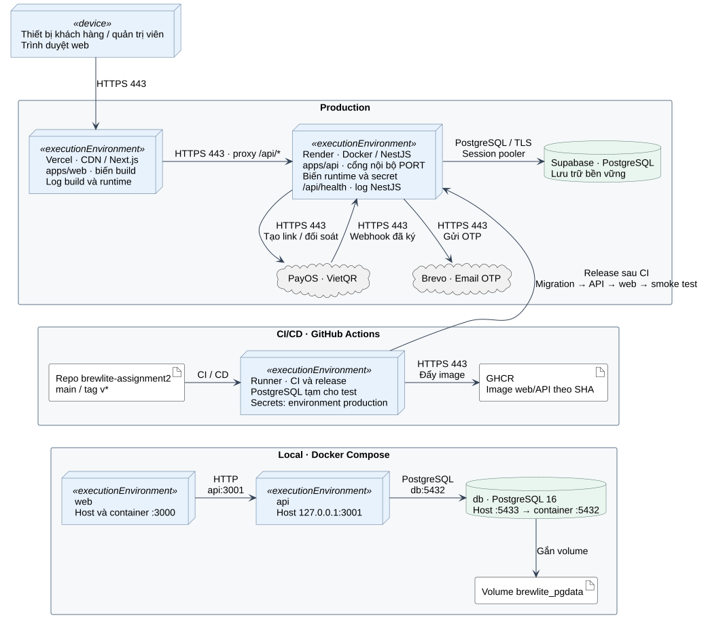

# Task 3.2 — Sơ đồ triển khai

[Mã nguồn PlantUML](deployment.puml) · [Bản PNG](deployment.png) · [Bản draw.io nhóm gửi](deployment-reference.drawio)

Sơ đồ dùng trong báo cáo đã được đối chiếu với cấu hình Assignment 2. Bản draw.io lưu thông tin tham khảo ban đầu của nhóm.

| Nút triển khai | Thành phần và mã nguồn tương ứng |
| --- | --- |
| Thiết bị khách hàng / quản trị viên | Trình duyệt truy cập Next.js qua HTTPS 443. Các màn hình nằm trong [apps/web/src/app](../../../apps/web/src/app/). |
| Vercel | Dịch vụ web của [apps/web](../../../apps/web/). Biến build `NEXT_PUBLIC_API_URL=/api` và `API_INTERNAL_URL` điều khiển [rewrite Next.js](../../../apps/web/next.config.ts). Theo dõi log build và runtime trên Vercel. |
| Render | [Dockerfile API](../../../apps/api/Dockerfile) chạy NestJS trên `PORT`, mặc định 3001 khi không có biến này. Render cung cấp HTTPS 443, cấu hình runtime `DATABASE_URL`, `JWT_SECRET`, `FRONTEND_URL`, `PAYOS_*` và `BREVO_*`. [Health check](../../../apps/api/src/app.controller.ts) kiểm tra PostgreSQL qua `GET /api/health`. API ghi log NestJS trên Render. |
| Supabase | PostgreSQL có lưu trữ bền vững. API dùng kết nối TLS qua Session pooler, cổng 5432 theo cấu hình triển khai. [Schema và migration Prisma](../../../apps/api/prisma/) nằm cùng API. |
| PayOS / Brevo | PayOS gửi webhook tới `POST /api/payments/payos-webhook` trên Render. Liên kết thanh toán và đối soát nằm trong [CheckoutModule](../../../apps/api/src/modules/checkout/). [EmailModule](../../../apps/api/src/modules/email/) dùng Brevo qua HTTPS cho production và hỗ trợ SMTP. |
| Docker Compose local | [docker-compose.yml](../../../docker-compose.yml) ghép cấu hình web, API và PostgreSQL. Web gọi `api:3001`, API gọi `db:5432`, volume `brewlite_pgdata` lưu dữ liệu. Web kiểm tra đường dẫn `/`, API kiểm tra `/api/products`, DB kiểm tra bằng `pg_isready`. Compose ghi log `json-file` có xoay vòng. |
| GitHub Actions và GHCR | [CI](../../../.github/workflows/ci.yml) kiểm thử trên PostgreSQL tạm. [CD](../../../.github/workflows/cd.yml) dùng secrets của environment `production`, lưu hai image theo SHA lên GHCR, chạy migration Supabase, phát hành API và web, rồi chạy smoke test. Render và Vercel build từ commit phát hành. |

Xem thêm [hướng dẫn cấu hình, migration và rollback](../../deployment.md) và [kiến trúc C4](../system-architecture.md).
