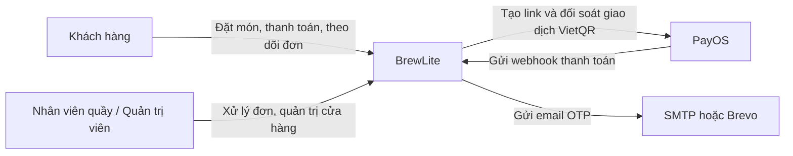
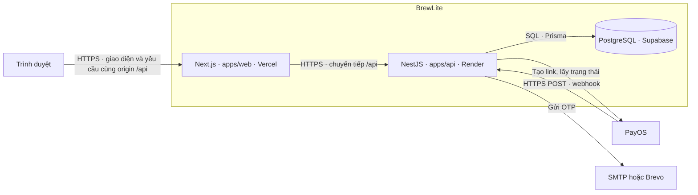

# Kiến trúc hệ thống BrewLite

BrewLite là hệ thống đặt và thanh toán đồ uống để nhận tại quầy. Tài liệu này mô tả kiến trúc Assignment 2 của Nhóm 04 theo ba mức C4 gồm ngữ cảnh hệ thống, container và thành phần API. Các quyết định kiến trúc được ghi trong ADR.

## 1. Ngữ cảnh hệ thống

Khách hàng dùng BrewLite để xem menu, chọn món, đặt đơn, thanh toán và theo dõi tiến độ. Nhân viên quầy dùng giao diện quản trị để xử lý đơn đã thanh toán. Quản trị viên quản lý thêm nguyên liệu, công thức và khuyến mãi. Các thao tác của nhân viên trên giao diện quản trị hiện dùng tài khoản có vai trò `ADMIN`.

PayOS phục vụ luồng VietQR khi kênh thanh toán được cấu hình. Luồng thẻ mô phỏng chạy nội bộ trong API và dùng được cho demo, kiểm thử tự động. Phạm vi MVP, mở rộng và các trường hợp ngoài phạm vi được mô tả trong [bối cảnh và phạm vi](../requirements/context-and-scope.md).

## 2. Kiến trúc container

| Container | Công nghệ và trách nhiệm |
| --- | --- |
| Web | Next.js và React với giao diện mobile-first. Zustand quản lý giỏ, giỏ được lưu trong `localStorage` theo tài khoản. TanStack Query quản lý dữ liệu API ở các màn hình sử dụng query. Trang checkout thăm dò trạng thái đơn để cập nhật kết quả. PWA là hạng mục mở rộng theo phạm vi dự án. |
| API | NestJS modular monolith. Các controller cung cấp API dưới tiền tố `/api`. Guard xử lý xác thực và phân quyền, DTO và validation pipe kiểm tra dữ liệu, các service thực thi nghiệp vụ. |
| Cơ sở dữ liệu | PostgreSQL lưu dữ liệu tài khoản, menu, công thức, kho, đơn, thanh toán và điểm thưởng. Prisma cung cấp lớp truy cập dữ liệu, schema và migration. Production dùng Supabase. Local có PostgreSQL qua Docker Compose. |

Web production gửi request cùng origin tới `/api`. [Cấu hình Next.js](../../apps/web/next.config.ts) chuyển tiếp request sang API qua `API_INTERNAL_URL`. Cách triển khai này giúp web sử dụng cookie xác thực trên cùng origin. Webhook PayOS gọi trực tiếp API trên Render.

## 3. Thành phần API

| Module | Trách nhiệm |
| --- | --- |
| `Auth`, `Email` | Đăng ký, xác minh OTP, đăng nhập, JWT, hồ sơ, mật khẩu và gửi email. |
| `Products`, `Inventory` | Menu, size, topping, công thức và kiểm tra, giữ, trừ hoặc hoàn nguyên liệu. |
| `Orders`, `Checkout` | Kiểm tra giỏ, tạo đơn, giữ kho, nhận kết quả thanh toán, xử lý hết hạn và trả trạng thái đơn. |
| `Promotions`, `Rewards` | Tính ưu đãi, ghi nhận điểm thưởng, đổi điểm lấy voucher và xử lý điểm khi hủy đơn đã thanh toán. |
| `Admin` | Xử lý trạng thái đơn tại quầy và quản lý nguyên liệu, công thức, khuyến mãi. |
| `Prisma` | Truy cập PostgreSQL và hỗ trợ transaction cho các thao tác liên quan nhiều module. |

Các module nằm trong [mã nguồn API](../../apps/api/src/modules/), được đăng ký trong [AppModule](../../apps/api/src/app.module.ts).

### PostgreSQL, migration và tồn kho

[Schema và migration Prisma](../../apps/api/prisma/) nằm cùng API. Nhóm tạo migration trên cơ sở dữ liệu phát triển bằng `prisma migrate dev`, lưu các migration vào Git và chạy `prisma migrate deploy` trong CI và phát hành production.

Tạo đơn `PENDING` giữ nguyên liệu theo công thức trong 120 giây. API kiểm tra tồn khả dụng bằng `onHand - reserved` và lưu snapshot công thức trong cùng transaction. Khi thanh toán thành công, API tiêu thụ phần giữ và ghi `CONSUMED`. Đơn quá hạn đủ điều kiện hủy sẽ trả phần giữ và ghi `RELEASED`. Admin hủy đơn đã thanh toán trong trạng thái cho phép thì kho được hoàn theo snapshot với trạng thái `RESTORED`, đồng thời hệ thống xử lý thu hồi điểm đã cấp.

### Dịch vụ thanh toán

- **Thẻ mô phỏng** chạy bên trong API và cung cấp luồng thanh toán có thể kiểm thử độc lập với PayOS. API dùng `Idempotency-Key` để trả lại kết quả của yêu cầu đã xử lý cho cùng đơn.
- **VietQR qua PayOS** dùng link thanh toán do API tạo. Webhook tới `POST /api/payments/payos-webhook`. API kiểm tra chữ ký, dữ liệu giao dịch và số tiền. API có thể đối soát trực tiếp khi truy vấn trạng thái đơn hoặc khi hết hạn.
- **Nhất quán dữ liệu** được bảo vệ bằng ràng buộc khóa duy nhất, khóa transaction và kiểm tra trạng thái đơn. Ghi nhận thanh toán thành công cập nhật đơn, kho và điểm trong một transaction. Với VietQR, API đối soát trước khi hủy đơn hết hạn và giải phóng nguyên liệu.

### Cấu hình, ghi log và health check

API dùng `ConfigModule` và biến môi trường. Các file `.env.example` cung cấp cấu hình mẫu. Render giữ cấu hình runtime của API, Vercel giữ cấu hình build của web, GitHub Actions dùng environment `production` cho workflow phát hành. Email hỗ trợ SMTP và Brevo. Hướng dẫn production dùng Brevo.

Các service dùng `Logger` của NestJS để ghi lỗi và tình huống cần theo dõi, ví dụ khi PayOS chưa xác minh được trạng thái giao dịch. `GET /api/health` kiểm tra PostgreSQL bằng `SELECT 1`, trả HTTP 200 khi kết nối được và HTTP 503 khi có lỗi. Workflow chạy smoke test sau khi triển khai API và web.

## 4. Lý do và đánh đổi

| Quyết định | Lợi ích | Hạn chế và đánh đổi |
| --- | --- | --- |
| Monorepo, triển khai web và API riêng | Một commit đồng bộ mã, migration, kiểm thử và tài liệu. Từng ứng dụng có thể build riêng. | Hai ứng dụng có cấu hình build và biến môi trường riêng. Đổi URL API cần cập nhật và build lại web. |
| Modular monolith | Một tiến trình API, dễ phối hợp nghiệp vụ và giao dịch PostgreSQL. | Các module chia sẻ tài nguyên của API. Tách và mở rộng từng module cần thiết kế thêm ranh giới triển khai. |
| PostgreSQL, snapshot công thức và giữ kho | Giảm nguy cơ bán vượt tồn và giữ được định lượng tại thời điểm đặt. | Nhóm phải duy trì công thức. Giao dịch VietQR chưa xác minh có thể giữ kho lâu hơn thời hạn thanh toán. |
| Thẻ mô phỏng và VietQR | Có luồng demo và CI ổn định, đồng thời hỗ trợ thanh toán thật khi PayOS được cấu hình. | VietQR phụ thuộc PayOS, mạng, webhook và cơ chế đối soát. |
| JWT và RBAC | Giao diện gửi cookie qua proxy cùng origin. API kiểm tra quyền theo vai trò và quyền sở hữu đơn. | Đọc người dùng từ PostgreSQL ở mỗi yêu cầu được bảo vệ để lấy quyền hiện tại. |
| Cấu hình theo môi trường và health check | Tách bí mật khỏi mã nguồn và xác nhận API, DB phản hồi sau rollout. | Health check chỉ phản ánh kết nối tại thời điểm gọi. Việc chẩn đoán cần log của môi trường chạy. |

## 5. Các quyết định kiến trúc

- [ADR 001 — Monorepo và triển khai production](adr/001-monorepo-workspace-structure.md)
- [ADR 002 — Backend NestJS theo kiến trúc modular monolith](adr/002-modular-monolith-backend-architecture.md)
- [ADR 003 — Tồn kho theo công thức và giữ nguyên liệu tạm thời](adr/003-recipe-based-inventory-and-reservation.md)
- [ADR 004 — Thanh toán mô phỏng, VietQR PayOS và Idempotency-Key](adr/004-payment-simulation-and-idempotency-key.md)
- [ADR 005 — Xác thực JWT và phân quyền theo vai trò](adr/005-stateless-jwt-authentication-and-rbac.md)
- [ADR 006 — Cấu hình tập trung, ghi log và health check](adr/006-centralized-configuration-logging-and-healthcheck.md)

## Tài liệu liên quan

- [Đặc tả yêu cầu phần mềm](../requirements/srs.md)
- [Sơ đồ nghiệp vụ](../diagrams/README.md)
- [Ma trận truy vết](../traceability-matrix.md)
- [Triển khai, migration và rollback](../deployment.md)
- [Bộ kiểm thử](../../tests/README.md)
