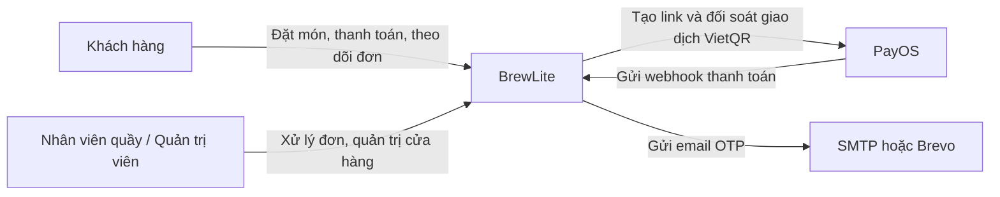
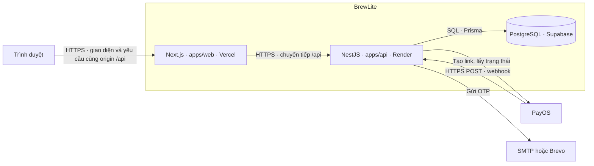
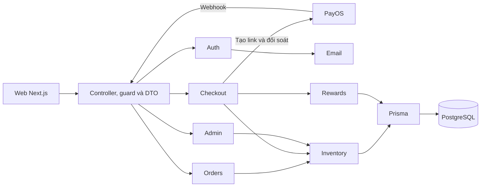

# Kiến trúc hệ thống BrewLite

BrewLite là hệ thống đặt và thanh toán đồ uống để nhận tại quầy. Tài liệu này mô tả kiến trúc Assignment 2 của Nhóm 04 theo ba mức C4 gồm ngữ cảnh hệ thống, container và thành phần API. Các quyết định kiến trúc được ghi trong ADR.

## 1. Ngữ cảnh hệ thống

Khách hàng dùng BrewLite để xem menu, chọn món, đặt đơn, thanh toán và theo dõi tiến độ. Nhân viên quầy dùng giao diện quản trị để xử lý đơn đã thanh toán. Quản trị viên quản lý thêm nguyên liệu, công thức và khuyến mãi. Các thao tác của nhân viên trên giao diện quản trị hiện dùng tài khoản có vai trò `ADMIN`.

PayOS phục vụ luồng VietQR khi kênh thanh toán được cấu hình. Luồng thẻ mô phỏng chạy nội bộ trong API và dùng được cho demo, kiểm thử tự động. Phạm vi MVP, mở rộng và các trường hợp ngoài phạm vi được mô tả trong [bối cảnh và phạm vi](../requirements/context-and-scope.md).

## 2. Kiến trúc container

| Container | Công nghệ và trách nhiệm |
| --- | --- |
| Web | Next.js và React với giao diện mobile-first. Zustand quản lý giỏ, giỏ được lưu trong `localStorage` theo tài khoản. TanStack Query quản lý dữ liệu API ở các màn hình sử dụng query. Trang checkout thăm dò trạng thái đơn để cập nhật kết quả. PWA là hạng mục mở rộng theo phạm vi dự án. |
| API | NestJS modular monolith. Các controller cung cấp API dưới tiền tố `/api`. Guard xử lý xác thực và phân quyền, DTO và validation pipe kiểm tra dữ liệu, các service thực thi nghiệp vụ. |
| Cơ sở dữ liệu | PostgreSQL lưu dữ liệu tài khoản, menu, công thức, kho, đơn, thanh toán và điểm thưởng. Prisma cung cấp lớp truy cập dữ liệu, schema và migration. Production dùng Supabase. Local có PostgreSQL qua Docker Compose. |

Web production gửi request cùng origin tới `/api`. [Cấu hình Next.js](../../apps/web/next.config.ts) chuyển tiếp request sang API qua `API_INTERNAL_URL`. Cách triển khai này giúp web sử dụng cookie xác thực trên cùng origin. Webhook PayOS gọi trực tiếp API trên Render.

### 2.1. Giao diện và trạng thái phía trình duyệt

Next.js App Router tổ chức màn hình theo luồng từ menu, chi tiết món, giỏ hàng đến checkout và lịch sử đơn. Giao diện quản trị nằm dưới `/admin`. TanStack Query quản lý trạng thái tải và dữ liệu lấy từ API ở các màn hình như menu. Giỏ dùng Zustand để cập nhật ngay trên giao diện và lưu món, voucher trong `localStorage`. Giỏ khách và giỏ đã đăng nhập dùng khóa riêng. Khi khách đăng nhập, web gộp hai giỏ theo món, size và topping. Cách lưu này giúp khôi phục giỏ sau khi tải lại trên cùng trình duyệt. [Các màn hình](../../apps/web/src/app/) · [Cart store](../../apps/web/src/stores/cart.store.ts)

Giá và lượng tồn trên giao diện giúp khách chọn món. API tính lại giá, ưu đãi và nhu cầu nguyên liệu trước khi tạo đơn. Trang checkout gọi API trạng thái theo chu kỳ hai giây để cập nhật kết quả thanh toán. API quyết định trạng thái đơn, thời điểm hết hạn và khả năng trả kho. [Giỏ hàng](../../apps/web/src/components/cart/CartContent.tsx) · [Checkout](../../apps/web/src/app/checkout/page.tsx)

### 2.2. Môi trường thực thi

| Môi trường | Web, API và cơ sở dữ liệu | Mục đích |
| --- | --- | --- |
| Local | Docker Compose chạy web, API và PostgreSQL 16. PostgreSQL lưu dữ liệu trong volume `brewlite_pgdata`. | Tái tạo stack, chạy demo với dữ liệu seed và thử migration trên dữ liệu local. |
| CI | GitHub Actions build từng app và chạy test tích hợp, E2E với PostgreSQL 16 tạm. | Kiểm tra schema và hành vi luồng đặt đơn bằng dữ liệu thử. |
| Production | Vercel phục vụ web, Render chạy API và Supabase lưu PostgreSQL. | Cung cấp web/API qua HTTPS và lưu dữ liệu đơn hàng giữa các lần phát hành. |

Quy trình phát hành chạy CI, lưu image web và API theo commit SHA trên GHCR, áp migration Supabase, triển khai API và web, rồi chạy smoke test. Render và Vercel build từ mã nguồn của commit phát hành. GHCR lưu image theo SHA để truy vết bản đóng gói. [Docker Compose](../../docker-compose.yml) · [CI](../../.github/workflows/ci.yml) · [CD](../../.github/workflows/cd.yml) · [Hướng dẫn triển khai](../deployment.md)

## 3. Thành phần API

| Module | Trách nhiệm |
| --- | --- |
| `Auth`, `Email` | Đăng ký, xác minh OTP, đăng nhập, JWT, hồ sơ, mật khẩu và gửi email. |
| `Products`, `Inventory` | Menu, size, topping, công thức và kiểm tra, giữ, trừ hoặc hoàn nguyên liệu. |
| `Orders`, `Checkout` | Kiểm tra giỏ, tạo đơn, giữ kho, nhận kết quả thanh toán, xử lý hết hạn và trả trạng thái đơn. |
| `Promotions`, `Rewards` | Tính ưu đãi, ghi nhận điểm thưởng, đổi điểm lấy voucher và xử lý điểm khi hủy đơn đã thanh toán. |
| `Admin` | Xử lý trạng thái đơn tại quầy và quản lý nguyên liệu, công thức, khuyến mãi. |
| `Prisma` | Truy cập PostgreSQL và hỗ trợ transaction cho các thao tác liên quan nhiều module. |

Các module nằm trong [mã nguồn API](../../apps/api/src/modules/), được đăng ký trong [AppModule](../../apps/api/src/app.module.ts).

### 3.1. Ranh giới giữa các thành phần

Controller nhận HTTP và chuyển yêu cầu cho service sau bước guard và validation. `OrdersService` điều phối tạo đơn và gọi `InventoryService` để giữ nguyên liệu. `CheckoutService` xác nhận thanh toán, điều phối tồn kho và gọi `RewardsService` để ghi điểm, xử lý voucher. Các service nhận cùng Prisma transaction khi cập nhật nhiều bảng trong một thao tác. `AdminService` dùng lại nghiệp vụ tồn kho khi xử lý hủy đơn từ màn hình quản trị. [Khởi tạo NestJS](../../apps/api/src/main.ts) · [OrdersService](../../apps/api/src/modules/orders/orders.service.ts) · [CheckoutService](../../apps/api/src/modules/checkout/checkout.service.ts) · [AdminService](../../apps/api/src/modules/admin/admin.service.ts)

Sơ đồ tập trung vào các thành phần của luồng đặt và thanh toán. Bảng trên liệt kê thêm module đọc danh mục và tính ưu đãi.

### 3.2. PostgreSQL, migration và tồn kho

[Schema và migration Prisma](../../apps/api/prisma/) nằm cùng API. Nhóm tạo migration trên cơ sở dữ liệu phát triển bằng `prisma migrate dev`, lưu các migration vào Git và chạy `prisma migrate deploy` trong CI và phát hành production.

Tạo đơn `PENDING` giữ nguyên liệu theo công thức trong 120 giây. API kiểm tra tồn khả dụng bằng `onHand - reserved` và lưu snapshot công thức trong cùng transaction. Khi thanh toán thành công, API tiêu thụ phần giữ và ghi `CONSUMED`. Đơn quá hạn đủ điều kiện hủy sẽ trả phần giữ và ghi `RELEASED`. Admin hủy đơn đã thanh toán trong trạng thái cho phép thì kho được hoàn theo snapshot với trạng thái `RESTORED`, đồng thời hệ thống xử lý thu hồi điểm đã cấp.

`Product` và các lựa chọn size/topping xác định thành phần công thức. `Recipe` liên kết món hoặc topping với `Ingredient`. `OrderItem` giữ bản chụp định lượng để các thao tác sau đó dùng lượng nguyên liệu đã tính lúc đặt. `Payment` ghi kết quả giao dịch và ràng buộc duy nhất trên `idempotencyKey`. `PayosPaymentLink` lưu liên kết giữa đơn và link PayOS, còn `PointTransaction` ghi biến động điểm. [Schema Prisma](../../apps/api/prisma/schema.prisma)

Khi nhiều khách đặt cùng lúc, câu lệnh tăng `reserved` chỉ thành công nếu lượng khả dụng còn đủ tại thời điểm ghi. API giữ nguyên liệu và tạo đơn trong cùng transaction, nên khi một bước lỗi thì PostgreSQL hoàn tác các thay đổi của transaction. `POST /api/cart/validate` là bước kiểm tra trước. Việc giữ tồn bắt đầu ở `POST /api/orders`. [Cart controller](../../apps/api/src/modules/inventory/cart.controller.ts) · [InventoryService](../../apps/api/src/modules/inventory/inventory.service.ts)

Với production, workflow xác minh đích triển khai và xác nhận đã rà baseline cùng bản sao lưu trước khi áp migration. Khi schema đã thay đổi, khôi phục phiên bản web/API và khôi phục dữ liệu là hai thao tác vận hành riêng. [Migration và rollback](../deployment.md)

### 3.3. Dịch vụ thanh toán

- **Thẻ mô phỏng** chạy bên trong API và cung cấp luồng thanh toán có thể kiểm thử độc lập với PayOS. API dùng `Idempotency-Key` để trả lại kết quả của yêu cầu đã xử lý cho cùng đơn.
- **VietQR qua PayOS** dùng link thanh toán do API tạo. Webhook tới `POST /api/payments/payos-webhook`. API kiểm tra chữ ký, dữ liệu giao dịch và số tiền. API có thể đối soát trực tiếp khi truy vấn trạng thái đơn hoặc khi hết hạn.
- **Nhất quán dữ liệu** được bảo vệ bằng ràng buộc khóa duy nhất, khóa transaction và kiểm tra trạng thái đơn. Ghi nhận thanh toán thành công cập nhật đơn, kho và điểm trong một transaction. Với VietQR, API đối soát trước khi hủy đơn hết hạn và giải phóng nguyên liệu.

| Tình huống | Cách xử lý |
| --- | --- |
| Gửi lại cùng `Idempotency-Key` cho cùng đơn | API trả kết quả đã ghi. Khóa dùng cho đơn khác bị từ chối. |
| Webhook và kiểm tra trạng thái đến cùng lúc | Khóa dòng đơn và kiểm tra lại kết quả trước khi ghi, để mỗi đơn chỉ được xác nhận và trừ kho một lần. |
| Quá hạn với link PayOS đã đóng và chưa nhận tiền | API hủy đơn và giải phóng nguyên liệu đã giữ. |
| Khách đã trả đủ và đơn còn giữ kho | API có thể xác nhận `PAID` qua đối soát ngay cả khi đã qua thời hạn chờ trên giao diện. |
| PayOS báo đã nhận một phần tiền, dữ liệu lệch hoặc cổng không phản hồi | API giữ nguyên đơn khi kết quả chưa đủ điều kiện xử lý. Giao dịch cần được đối soát thêm. |

Tác vụ NestJS quét các đơn quá hạn mỗi 30 giây. Việc quét và kiểm tra trạng thái đều đọc lại đơn trong transaction trước khi quyết định hủy. [CheckoutService](../../apps/api/src/modules/checkout/checkout.service.ts) · [Test đối soát PayOS](../../apps/api/test/payos-reconciliation.integration-spec.ts)

### 3.4. Xác thực và phân quyền

Sau khi đăng nhập, API phát JWT qua cookie `HttpOnly`, `SameSite=Lax` và `Secure` ở production. `JwtStrategy` chấp nhận cookie và hỗ trợ Bearer token. Sau khi xác minh JWT, API đọc tài khoản để lấy vai trò hiện tại. Các route quản trị yêu cầu `ADMIN`. API lịch sử, chi tiết đơn và checkout kiểm tra người dùng sở hữu đơn. Webhook PayOS dùng chữ ký của cổng để xác thực request. [Auth controller](../../apps/api/src/modules/auth/auth.controller.ts) · [JWT strategy](../../apps/api/src/modules/auth/strategies/jwt.strategy.ts) · [Roles guard](../../apps/api/src/modules/auth/guards/roles.guard.ts)

### 3.5. Cấu hình, ghi log và health check

API dùng `ConfigModule` và biến môi trường. Các file `.env.example` cung cấp cấu hình mẫu. Render giữ cấu hình runtime của API, Vercel giữ cấu hình build của web, GitHub Actions dùng environment `production` cho workflow phát hành. Email hỗ trợ SMTP và Brevo. Hướng dẫn production dùng Brevo.

Các service dùng `Logger` của NestJS để ghi lỗi và tình huống cần theo dõi, ví dụ khi PayOS chưa xác minh được trạng thái giao dịch. `GET /api/health` kiểm tra PostgreSQL bằng `SELECT 1`, trả HTTP 200 khi kết nối được và HTTP 503 khi có lỗi. Workflow chạy smoke test sau khi triển khai API và web.

| Nơi đặt cấu hình | Biến và vai trò |
| --- | --- |
| Vercel | `NEXT_PUBLIC_API_URL` là đường dẫn gọi API từ trình duyệt. `API_INTERNAL_URL` là đích rewrite khi build web. |
| Render | `DATABASE_URL` kết nối PostgreSQL, `JWT_SECRET` dùng ký JWT và `FRONTEND_URL` cấu hình origin web. Nhóm `PAYOS_*` cấu hình thanh toán. `MAIL_PROVIDER` chọn cách gửi email. |
| GitHub Actions | Environment `production` giữ biến xác nhận baseline và secrets để chạy migration, xác minh dự án đích và triển khai. |

Smoke test kiểm tra API health và menu trên Render, sau đó kiểm tra trang chủ và API health qua Vercel. Lỗi health trực tiếp cần đối chiếu log Render và kết nối PostgreSQL. Khi API trực tiếp khỏe và proxy web lỗi, kiểm tra cấu hình rewrite của bản web vừa build. [Health controller](../../apps/api/src/app.controller.ts) · [Workflow CD](../../.github/workflows/cd.yml)

## 4. Lý do và đánh đổi

| Quyết định | Lợi ích | Hạn chế và đánh đổi |
| --- | --- | --- |
| Monorepo, triển khai web và API riêng | Một commit đồng bộ mã, migration, kiểm thử và tài liệu. Từng ứng dụng có thể build riêng. | Hai ứng dụng có cấu hình build và biến môi trường riêng. Đổi URL API cần cập nhật và build lại web. |
| Modular monolith | Một tiến trình API, dễ phối hợp nghiệp vụ và giao dịch PostgreSQL. | Các module chia sẻ tài nguyên của API. Tách và mở rộng từng module cần thiết kế thêm ranh giới triển khai. |
| PostgreSQL, snapshot công thức và giữ kho | Giảm nguy cơ bán vượt tồn và giữ được định lượng tại thời điểm đặt. | Nhóm phải duy trì công thức. Giao dịch VietQR chưa xác minh có thể giữ kho lâu hơn thời hạn thanh toán. |
| Thẻ mô phỏng và VietQR | Có luồng demo và CI ổn định, đồng thời hỗ trợ thanh toán thật khi PayOS được cấu hình. | VietQR phụ thuộc PayOS, mạng, webhook và cơ chế đối soát. |
| JWT và RBAC | Giao diện gửi cookie qua proxy cùng origin. API kiểm tra quyền theo vai trò và quyền sở hữu đơn. | Đọc người dùng từ PostgreSQL ở mỗi yêu cầu được bảo vệ để lấy quyền hiện tại. |
| Cấu hình theo môi trường và health check | Tách bí mật khỏi mã nguồn và xác nhận API, DB phản hồi sau rollout. | Health check chỉ phản ánh kết nối tại thời điểm gọi. Việc chẩn đoán cần log của môi trường chạy. |

Nhóm chọn modular monolith vì đặt đơn, giữ kho, thanh toán và ghi điểm dùng chung dữ liệu và có bước phải hoàn tất trong một transaction. Việc tách các bước này thành nhiều dịch vụ sẽ cần thêm cơ chế phối hợp giao dịch và xử lý lỗi giữa các dịch vụ. Khi quy mô tăng, các số đo nên theo dõi gồm thời gian giữ khóa dòng đơn, số lượt đối soát PayOS, số kết nối PostgreSQL và thời gian phản hồi ở các endpoint chính.

## 5. Các quyết định kiến trúc

- [ADR 001 — Monorepo và triển khai production](adr/001-monorepo-workspace-structure.md)
- [ADR 002 — Backend NestJS theo kiến trúc modular monolith](adr/002-modular-monolith-backend-architecture.md)
- [ADR 003 — Tồn kho theo công thức và giữ nguyên liệu tạm thời](adr/003-recipe-based-inventory-and-reservation.md)
- [ADR 004 — Thanh toán mô phỏng, VietQR PayOS và Idempotency-Key](adr/004-payment-simulation-and-idempotency-key.md)
- [ADR 005 — Xác thực JWT và phân quyền theo vai trò](adr/005-stateless-jwt-authentication-and-rbac.md)
- [ADR 006 — Cấu hình tập trung, ghi log và health check](adr/006-centralized-configuration-logging-and-healthcheck.md)

## Tài liệu liên quan

- [Đặc tả yêu cầu phần mềm](../requirements/srs.md)
- [Sơ đồ nghiệp vụ](../diagrams/README.md)
- [Ma trận truy vết](../traceability-matrix.md)
- [Triển khai, migration và rollback](../deployment.md)
- [Bộ kiểm thử](../../tests/README.md)
