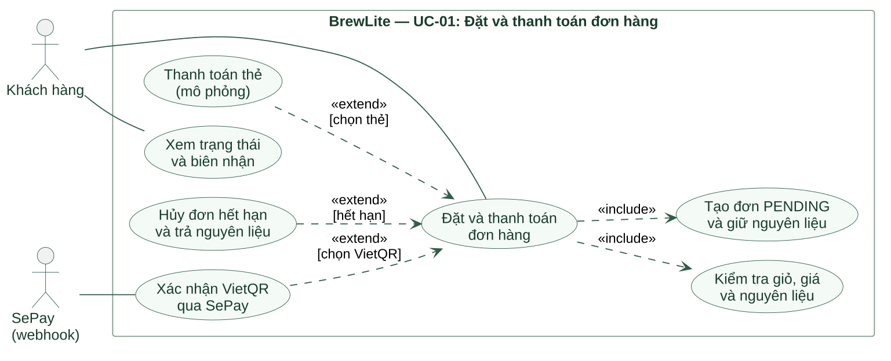

# UC-01 — Đặt và thanh toán đơn hàng (Task 1.3)

Bản nháp này chưa được đưa vào [báo cáo tổng hợp](task1/main.tex). Nội dung LaTeX riêng nằm ở [1.3-use-case.tex](task1/1.3-use-case.tex); có thể dùng sau khi hoàn thiện Task 1.3.

[Nguồn PlantUML](../diagrams/uc01-order-checkout.puml) · [Ảnh PNG dùng trong báo cáo LaTeX](../diagrams/uc01-order-checkout.png)

## Phạm vi và actor

| Thuộc tính | Đặc tả |
| --- | --- |
| Mục tiêu | Tạo đơn từ giỏ hợp lệ, thanh toán trong hạn, nhận biên nhận; đơn chưa thanh toán không đi vào pha chế. |
| Actor chính | Khách hàng. |
| Actor hỗ trợ | PayOS tạo link VietQR và gửi webhook xác nhận giao dịch. Thanh toán thẻ trong ứng dụng là mô phỏng. |
| Trigger | Khách bấm **Tiến hành thanh toán** ở giỏ. |
| Tiền điều kiện | Giỏ có ít nhất một món; cần đăng nhập trước khi gọi API tạo đơn. Giá, công thức, nguyên liệu và voucher được xác minh trong luồng. |
| Thành công | Đơn `PAID`, một payment thành công, nguyên liệu đã giữ được tiêu thụ một lần, điểm/voucher được ghi theo quy tắc, khách thấy biên nhận. |
| Không thành công | Giỏ sai không tạo đơn; thanh toán lỗi còn giữ nguyên liệu đến hạn; hết hạn thì `CANCELLED` và trả lượng `reserved`. |

**Trong phạm vi:** kiểm tra giỏ, tạo đơn, giữ/trả nguyên liệu, thanh toán, hiển thị trạng thái và biên nhận. **Ngoài phạm vi:** nhập kho, sửa công thức, pha chế/giao đồ, giao tận nơi, hoàn tiền ngân hàng tự động. Mở QR hoặc bấm **Đã chuyển tiền** không có nghĩa đã thanh toán.

## Luồng chính

1. Khách xem giỏ, sửa món/số lượng rồi bấm **Tiến hành thanh toán**.
2. Giao diện kiểm tra phiên và gọi `POST /api/cart/validate`; máy chủ đọc lại món, size, topping, giá, công thức và nguyên liệu.
3. Khi giỏ hợp lệ, giao diện gọi `POST /api/orders`. Máy chủ tính lại tiền/voucher; trong một transaction kiểm tra lại tồn, giữ nguyên liệu và lưu đơn cùng các dòng món.
4. API trả `orderId`, trạng thái `PENDING`, tổng tiền và hạn hai phút. Giao diện mở `/checkout?orderId=...`, lấy hạn từ máy chủ.
5. Khách chọn **thẻ mô phỏng** rồi gửi `POST /api/checkout` với `Idempotency-Key`, hoặc quét **VietQR PayOS**. API xác minh chữ ký webhook và đối chiếu mã link cùng số tiền trước khi hoàn tất đơn.
6. Khi thanh toán thành công, máy chủ ghi payment, chuyển đơn `PAID`, tiêu thụ nguyên liệu đã giữ, ghi điểm/voucher. Giao diện hiện biên nhận và xóa giỏ cục bộ.

## Luồng thay thế

- **A1 — Chưa đăng nhập:** yêu cầu đăng nhập; API tạo đơn từ chối request thiếu phiên. Giỏ vẫn còn, chưa giữ nguyên liệu.
- **A2 — Giỏ/voucher không hợp lệ:** báo lỗi món, size, topping, số lượng, công thức, mã ưu đãi hoặc nguyên liệu; khách sửa rồi thử lại. Bước tạo đơn kiểm tra lại giá/tồn trước khi commit.
- **A3 — Chọn phương thức khác:** đổi giữa thẻ mô phỏng và VietQR khi đơn còn hạn; không tạo đơn mới vì đổi phương thức.
- **A4 — Thanh toán mô phỏng lỗi:** ghi payment `FAILED`, đơn `PAYMENT_FAILED`, giữ nguyên liệu đến hết hạn và cho thử lại với khóa mới.
- **A5 — Tạo lại sau hết hạn:** giao diện cho một lượt tạo lại; đơn cũ đã hủy và trả nguyên liệu. Gọi `POST /api/orders` lần nữa để lấy `orderId` mới, hạn mới và kiểm tra lại tồn. Giới hạn một lượt hiện nằm ở giao diện, chưa được API cưỡng chế.

## Luồng ngoại lệ

- **E1 — Hết hạn:** sau hai phút, đơn `PENDING`/`PAYMENT_FAILED` thành `CANCELLED`; API/tác vụ nền giải phóng `reserved`. Không thanh toán lại đơn cũ.
- **E2 — Gửi lặp:** cùng `Idempotency-Key` nhận kết quả cũ; không ghi payment, trừ tồn hay cộng điểm lần hai. Khóa đã dùng cho đơn khác bị từ chối.
- **E3 — Sai quyền/trạng thái:** thiếu phiên, orderId của người khác, đơn đã trả/hủy/quá hạn bị từ chối.
- **E4 — Lỗi transaction/tranh chấp tồn:** thay đổi DB trong transaction được rollback; giỏ vẫn còn để thử lại.
- **E5 — Chưa có tín hiệu PayOS:** giao diện tiếp tục chờ. Giao dịch được thông báo sau khi đơn đã hủy cần đối soát riêng.

## Tiêu chí nghiệm thu và truy vết

| Mã | Kết quả cần kiểm tra | Yêu cầu nguồn |
| --- | --- | --- |
| UC01-AC01 | Giỏ hợp lệ tạo một đơn `PENDING`, có mã/tổng tiền/hạn hai phút, tăng `reserved` đúng công thức. | FR-03, FR-04, FR-08 |
| UC01-AC02 | Chưa đăng nhập, giỏ sai, voucher lỗi hoặc thiếu nguyên liệu không lưu đơn/giữ nguyên liệu. | FR-04, FR-06, FR-08, FR-13 |
| UC01-AC03 | Sửa giá/tổng tiền ở client không ảnh hưởng số tiền được ghi trên đơn. | FR-08, NFR-02 |
| UC01-AC04 | Thẻ mô phỏng thành công trong hạn tạo một payment, đơn `PAID`, giảm `onHand`/`reserved`, hiện biên nhận. | FR-09, NFR-03 |
| UC01-AC05 | VietQR chỉ xác nhận khi webhook khớp; mở QR hoặc bấm kiểm tra không tạo payment thành công. | FR-09, NFR-03 |
| UC01-AC06 | Gửi lặp khóa hoặc request đồng thời không trừ tồn/cộng điểm hai lần. | FR-09, FR-14, NFR-03 |
| UC01-AC07 | Thanh toán lỗi còn hạn được thử lại; hết hạn hủy và trả `reserved` một lần. | FR-09, FR-10 |
| UC01-AC08 | Lượt tạo lại dùng mã đơn mới và kiểm tra tồn tại thời điểm mới. | FR-04, FR-08, FR-10 |
| UC01-AC09 | Khách chỉ xem/thanh toán đơn của mình và xem được biên nhận sau khi trả thành công. | FR-09, FR-11, NFR-02 |

**Cần nghiệm thu riêng:** Quy tắc một lần tạo lại hiện chỉ được lưu trên trình duyệt, nên API chưa ngăn thao tác từ thiết bị khác. Giao dịch PayOS được thông báo sau khi đơn đã hủy cần quy trình đối soát riêng.
